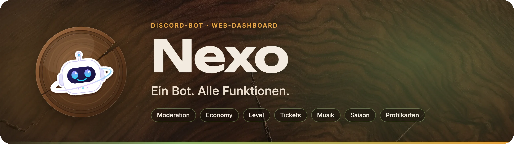
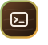
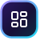
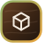
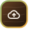
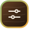
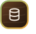
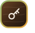
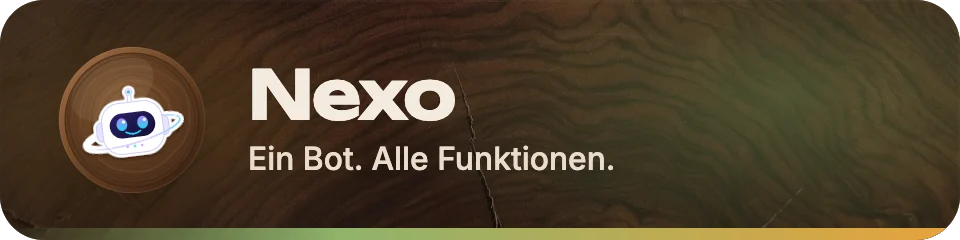

<p align="center">
  
</p>

<p align="center">
  <a href="https://www.npmjs.com/package/discord.js"></a>
  
  
  
  <a href="LICENSE"></a>
  <a href="https://discord.gg/DuhdCbTaB"></a>
</p>

**NexoBot** (Anzeigename „Nexo“) ist ein modularer Discord-Community-Bot mit Moderation, Economy, Leveling, Tickets, Musik, Giveaways, Verifizierung und vielen Werkzeugen. Dazu kommen ein eigenes Profil mit Karten, Shop und Saison sowie ein Web-Dashboard. Geschrieben in TypeScript mit discord.js v14, das Dashboard mit React, Vite und Tailwind, PostgreSQL als Datenspeicher.

> **Herkunft:** NexoBot basiert auf [TitanBot](https://github.com/codebymitch/TitanBot) von codebymitch (MIT-Lizenz) und wurde für diesen Bot überarbeitet: Rebranding, Umstellung auf TypeScript, zusammengefasste Commands und deutsche Texte.

## Inhalt

- [Funktionen](#funktionen)
  - [Profil, Shop und Saison](#profil-shop-und-saison)
  - [Nachrichten im Nexo-Design](#nachrichten-im-nexo-design)
- [Commands](#commands)
- [Web-Dashboard](#web-dashboard)
- [Einrichtung](#einrichtung)
  - [Lokal](#lokal)
  - [Docker](#docker)
  - [Railway](#railway)
- [Umgebungsvariablen](#umgebungsvariablen)
- [Intents und Berechtigungen](#intents-und-berechtigungen)

## Funktionen

- **Moderation** – Ban, Kick, Timeout, Verwarnungen, Fälle, Massenaktionen, Kanal-Sperren, Nutzernotizen
- **AutoMod** – Spam, Links, Einladungen, Schimpfwörter und Massen-Erwähnungen über Discords eingebauten AutoMod (`/automod`), wirkt auch, wenn der Bot offline ist
- **Economy** – Kontostand, Arbeit, Shop, Inventar, Glücksspiel, Überweisungen, Bestenliste
- **Leveling** – XP für Nachrichten, Rangkarten, Level-Rollen, Bestenliste
- **Tickets** – Panels, Claim, Priorität, Transkripte, Limits
- **Musik** – Lavalink v4 über Riffy, Warteschlange, Buttons, 24/7-Modus
- **Giveaways** – mehrere Gewinner, automatische Auslosung, Reroll
- **Willkommen** – Begrüßung, Abschied, Auto-Rollen
- **Verifizierung** – Button-Verifizierung und Auto-Verify
- **Weitere Module** – Geburtstage, Reaktionsrollen, Join-to-Create, Server-Statistiken, Logging, Bewerbungen, Zählspiel, Todo-Listen, Suche und viele Werkzeuge
- **Spiele** – `/fun spiel`: Vier gewinnt, Tic-Tac-Toe und ein Quiz-Duell mit Buttons; per Rechtsklick auf ein Mitglied lässt sich auch direkt herausfordern
- **Events** – Nexo trägt auf jedem Server den Look des laufenden Events, jeder Server schreibt auf ein Gemeinschaftsziel hin; der Status wechselt zwischen Event, Saison, Aufgaben und Spielen
- **Musik-Status** – der laufende Titel steht als Status im Sprachkanal

Alle Funktionen lassen sich pro Server über `/configwizard` und `/commands` oder bequem im [Web-Dashboard](#web-dashboard) konfigurieren und einzeln sperren.

### Profil, Shop und Saison

Jedes Mitglied hat ein Nexo-Profil, das auf allen Servern gilt:

- **Profilkarte** – gestaltbare Karte mit Level, Rang und Bernis, Begleiter am Avatar, die mit den Chat-Tagen wachsen; per `/profil ansehen` oder Rechtsklick → *Profilkarte ansehen*
- **Bernis** – die Währung als Münzen in Platin, Gold, Silber und Bronze (je 100 der nächstkleineren), in Discord als eigene Emojis
- **Shop und Schwarzmarkt** – Hintergründe, Avatar-Rahmen, Abzeichen, Titel, Schriften, Effekte, Sticker, Begleiter und mehr, dazu ein wöchentlicher Schwarzmarkt und über 80 Erfolge
- **Tagesbonus und Tagesaufgaben** – Serien mit Serien-Schutz, drei Aufgaben pro Tag, die sich selbst auszahlen; auf Wunsch eine Erinnerung per DM um 19 Uhr
- **Saison** – jeden Monat ein Pfad mit zehn Stufen und Stücken, die es nur in dieser Saison gibt
- **Dein Nexo-Jahr** – `/profil jahr` fasst das Jahr als Karte zum Teilen zusammen
- **Profil-Links und verknüpfte Rollen** – öffentliche Profil-Links zeigen in Discord die Karte als Vorschau (freiwillig); Server können über Linked Roles Rollen nach Level, Saison-Stufe, Erfolgen, Chat-Tagen und Bernis vergeben

### Nachrichten im Nexo-Design

Antworten und gepostete Nachrichten (Tickets, Giveaways, Panels, Logs, Willkommen) erscheinen als Nexo-Karten (Discord Components V2):

- oben ein Banner in der Farbe der Aktion, mit dem Motiv groß in der Mitte und klein im Hintergrund
- darunter Überzeile, Titel und klar getrennte Abschnitte; Commands sind anklickbar
- jede Antwort in der Farbvorlage, die sich das Mitglied im Dashboard ausgesucht hat (zwölf Vorlagen)
- Knöpfe nach Aktion gefärbt: grün zum Bestätigen und Mitmachen, rot zum Löschen und Beenden, sonst blau; Emojis tragen nur Link-Knöpfe

Die Banner zeichnet Nexo selbst und liefert sie über das Dashboard aus. Dafür muss `DASHBOARD_URL` eine öffentliche https-Adresse sein, sonst kommen die Karten ohne Banner.

## Commands

NexoBot bündelt die Funktionen in thematische Commands mit Subcommands, zum Beispiel `/eco balance`, `/mod warn` oder `/music play`. Das Profil hat einen eigenen Command: `/profil` mit `ansehen`, `bernis`, `shop`, `aufgaben`, `erinnerung`, `jahr` und `rollen`. Dazu kommen zwei Einträge im Rechtsklick-Menü eines Mitglieds: *Profilkarte ansehen* und *Zum Spiel herausfordern*. Die vollständige Zuordnung der früheren Einzel-Commands steht in [docs/COMMAND_MIGRATION.md](docs/COMMAND_MIGRATION.md). `/help` zeigt alle Commands im Bot an.

## Web-Dashboard

Nexo bringt ein Web-Dashboard mit, das im selben Dienst wie der Bot unter `/dashboard` läuft. Server-Admins melden sich mit Discord an und sehen alle Server, auf denen sie „Server verwalten“ haben. Dort lassen sich alle Module einstellen, die es auch als Commands gibt: Willkommen, Leveling, Tickets, Verifizierung, Reaktionsrollen, AutoMod, Logging, Giveaways und mehr. Dazu kommen ein Designer für Willkommens- und Abschiedskarten (Bild mit Avatar, Texten, Formen und eigenen Bildern) und eine Statistikseite mit Mitgliederentwicklung, Aktivität und Zahlen aus allen Modulen, die Nexo ab dem ersten Tag täglich aufzeichnet. Das Dashboard ist für alle Server kostenlos.

Unter **Mein Profil** gestaltet jedes Mitglied seine Profilkarte, kauft im Shop und auf dem Schwarzmarkt ein, verwaltet sein Inventar und sieht Verlauf, Ranglisten, Erfolge und Saison. Unter **Dashboard-Design** wählt es eine von zwölf Farbvorlagen und hell oder dunkel; Nexos Antworten an dieses Mitglied folgen derselben Vorlage. Bot-Besitzer (`OWNER_IDS`) pflegen im Bereich **Owner** Artikel, Events, den Schwarzmarkt und Bernis.

Über **Nexo einladen** auf der Startseite (`<DASHBOARD_URL>/dashboard`) fügen Admins Nexo ihrem Server hinzu und landen danach direkt im Dashboard dieses Servers. Im Discord führt der Button **Dashboard** in `/help` dorthin.

Einrichtung:

1. Im [Discord Developer Portal](https://discord.com/developers/applications) unter **OAuth2** das Client Secret kopieren und als Redirect `<DASHBOARD_URL>/dashboard/auth/callback` eintragen, zum Beispiel `http://localhost:3000/dashboard/auth/callback` lokal oder `https://<dein-dienst>.up.railway.app/dashboard/auth/callback` auf Railway.
2. `DISCORD_CLIENT_SECRET`, `SESSION_SECRET` (z. B. `openssl rand -hex 32`) und `DASHBOARD_URL` setzen.
3. Auf Railway unter **Settings → Networking** eine öffentliche Domain erzeugen.
4. Für verknüpfte Rollen im Developer Portal unter **General Information** die *Linked Roles Verification URL* `<DASHBOARD_URL>/dashboard/linked-role` eintragen.

Ohne `DISCORD_CLIENT_SECRET` oder `SESSION_SECRET` bleibt das Dashboard deaktiviert und der Bot läuft normal weiter. `npm run build` baut Bot und Dashboard; für die Entwicklung startet `npm run dev:dashboard` einen Vite-Server mit Proxy auf den laufenden Bot.

## Einrichtung

Voraussetzungen: ein Bot im [Discord Developer Portal](https://discord.com/developers/applications) mit Token und Client-ID sowie den unten genannten Intents.

### Lokal

Benötigt Node.js 20.10 oder neuer und PostgreSQL.

```bash
git clone https://github.com/Robertwlt03/NexoBot.git
cd NexoBot
npm install
cp .env.example .env   # DISCORD_TOKEN, CLIENT_ID und Datenbank eintragen
npm run build
npm start
```

Für die Entwicklung startet `npm run dev` den Bot mit automatischem Neuladen direkt aus den TypeScript-Quellen. `npm run typecheck` prüft die Typen ohne Build. `npm test` führt die Tests aus.

Eine lokale Datenbank lässt sich am einfachsten per Docker starten:

```bash
docker compose up -d db
```

Die Compose-Datenbank läuft dann auf `127.0.0.1:5432` (User/Passwort/DB aus `POSTGRES_USER`, `POSTGRES_PASSWORD`, `POSTGRES_DB`). Sie hat kein SSL: Setze `POSTGRES_SSL=false`, sonst schlägt die Verbindung mit `NODE_ENV=production` fehl und der Bot läuft im In-Memory-Modus.

### Docker

```bash
cp .env.example .env   # mindestens DISCORD_TOKEN, CLIENT_ID, GUILD_ID setzen
docker compose up -d --build
```

Compose startet den Bot und PostgreSQL. Die Datenbank-Defaults (`nexobot` / `password` / `nexobot`) lassen sich über `POSTGRES_USER`, `POSTGRES_PASSWORD` und `POSTGRES_DB` in der `.env` überschreiben. Einen eigenen Lavalink-Knoten startet das Profil `local-lavalink`:

```bash
docker compose --profile local-lavalink up -d
```

Fertige Images: `ghcr.io/robertwlt03/nexobot`.

### Railway

1. Repository in Railway verbinden und einen PostgreSQL-Dienst hinzufügen.
2. Im Bot-Dienst `DISCORD_TOKEN`, `CLIENT_ID` und `GUILD_ID` setzen und `POSTGRES_URL` bzw. `DATABASE_URL` auf die private Railway-Datenbank-URL verweisen lassen.
3. Railway baut über das `Dockerfile`. Migrationen laufen beim Start automatisch (`AUTO_MIGRATE=true`).

Healthchecks: `GET /health` (Prozess lebt) und `GET /ready` (Bot verbunden und Datenbank bereit).

## Umgebungsvariablen

Alle Variablen mit Beispielwerten stehen in [.env.example](.env.example). Die wichtigsten:

| Variable | Pflicht | Beschreibung |
| --- | --- | --- |
| `DISCORD_TOKEN` | ja | Bot-Token aus dem Developer Portal |
| `CLIENT_ID` | ja | Application-ID; Slash-Commands werden global registriert |
| `GUILD_ID` | nein | Server-ID für die Einrichtung |
| `OWNER_IDS` | nein | Kommagetrennte Discord-IDs der Bot-Besitzer |
| `POSTGRES_URL` / `DATABASE_URL` | empfohlen | Verbindungs-URL zur Datenbank |
| `POSTGRES_HOST`, `POSTGRES_PORT`, `POSTGRES_DB`, `POSTGRES_USER`, `POSTGRES_PASSWORD` | alternativ | Einzelwerte statt URL |
| `POSTGRES_SSL` | nein | SSL erzwingen (`true`/`false`) |
| `AUTO_MIGRATE` | nein | Migrationen beim Start ausführen (Standard `true`) |
| `PORT`, `WEB_HOST` | nein | Port und Host für `/health`, `/ready` und das Dashboard (Standard `3000`, `0.0.0.0`) |
| `DISCORD_CLIENT_SECRET` | für Dashboard | OAuth2 Client Secret für die Discord-Anmeldung |
| `SESSION_SECRET` | für Dashboard | Zufälliger Schlüssel zum Signieren der Sitzungs-Cookies |
| `DASHBOARD_URL` | für Dashboard | Öffentliche Basis-URL ohne `/dashboard`, z. B. `https://nexo.up.railway.app` (Standard `http://localhost:<PORT>`). Banner auf den Karten, Profil-Links und Linked Roles brauchen eine öffentliche https-Adresse |
| `LOG_LEVEL`, `LOG_TO_FILE` | nein | Log-Level und Datei-Logging |
| `LAVALINK_NODES_FILE`, `LAVALINK_NODES` | nein | Lavalink-Knoten für Musik |
| `TMDB_API_KEY` | nein | Für die Film- und Seriensuche |
| `SENTRY_DSN` | nein | Fehler an Sentry melden |

Ohne erreichbare Datenbank läuft der Bot in einem eingeschränkten In-Memory-Modus. Für den Produktivbetrieb ist PostgreSQL Pflicht.

### Datenbank-Werkzeuge

```bash
npm run migrate          # Schema-Migrationen anwenden
npm run migrate:status   # Stand anzeigen
npm run migrate:check    # prüfen, ob Migrationen offen sind
npm run backup:db        # Backup erstellen (pg_dump)
npm run restore:db       # Backup einspielen
```

Die Skripte laufen aus `dist/scripts/`, also vorher `npm run build` ausführen.

## Intents und Berechtigungen

Im Developer Portal aktivieren (Privileged Gateway Intents):

- **Server Members Intent**
- **Message Content Intent**

Der Bot nutzt außerdem die Intents Guilds, Guild Messages, Guild Message Reactions, Guild Voice States, Guild Moderation (Bans) und Direct Messages.

Einladung mit den Scopes `bot` und `applications.commands` und diesen Berechtigungen:

- Kanäle ansehen, Nachrichten senden, Links einbetten, Dateien anhängen, Nachrichtenverlauf lesen, Reaktionen hinzufügen, externe Emojis verwenden
- Nachrichten verwalten, Kanäle verwalten, Rollen verwalten
- Server verwalten (für `/automod`), Audit-Log ansehen
- Mitglieder kicken, Mitglieder bannen, Mitglieder moderieren (Timeout)
- Verbinden, Sprechen und Mitglieder verschieben (Musik, Join-to-Create)

Die Einladung über **Nexo einladen** im Dashboard fragt genau diese Berechtigungen an.

<p align="center">
  
</p>

<p align="center">
  <b>Nexo · Ein Bot. Alle Funktionen.</b><br>
  <sub>© 2026 Robertwlt03 · Veröffentlicht unter der <a href="LICENSE">MIT-Lizenz</a></sub><br>
  <sub>Hilfe, Bugs und Ideen: <a href="https://discord.gg/DuhdCbTaB">Discord-Server</a></sub><br>
  <sub>Basiert auf <a href="https://github.com/codebymitch/TitanBot">TitanBot</a> von codebymitch (MIT) und für NexoBot überarbeitet</sub>
</p>
