

  

  
  
  
  
  
  

**Nexo** ist ein Discord-Bot für Communitys: Moderation, Tickets, Level, Musik, Giveaways und vieles mehr in einem Bot, eingerichtet im Browser statt über lange Command-Listen. Dazu bekommt jedes Mitglied ein eigenes Profil mit Profilkarte, Shop, Tagesaufgaben und Saison, das auf allen Servern mit Nexo gilt.

## So sieht Nexo in Discord aus

Jede Antwort ist eine Nexo-Karte mit Banner in der Farbe der Aktion. Knöpfe zeigen, was sie tun: grün zum Mitmachen, rot zum Beenden. Bernis erscheinen als eigene Münzen.

<table>
  <tr>
    <td width="50%" valign="top">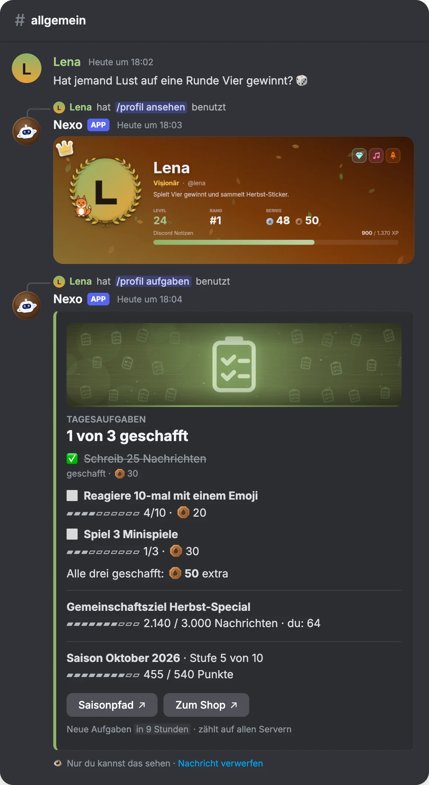</td>
    <td width="50%" valign="top">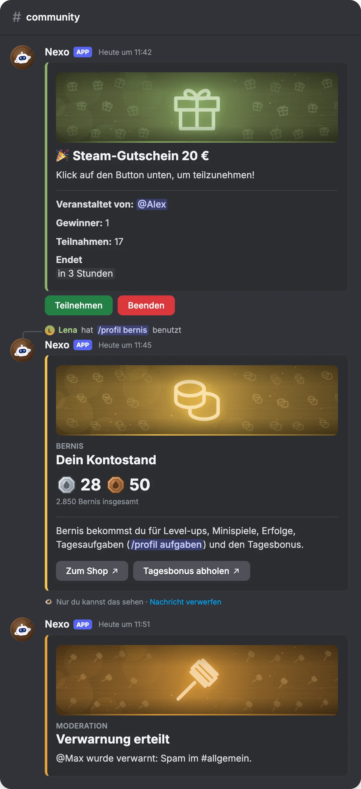</td>
  </tr>
  <tr>
    <td align="center">Profilkarte und Tagesaufgaben</td>
    <td align="center">Gewinnspiel, Kontostand und Moderation</td>
  </tr>
</table>

### Die Profilkarte

Jedes Mitglied gestaltet seine Karte selbst: Hintergründe, Rahmen, Titel, Abzeichen, Sticker und Begleiter aus dem Shop, dazu Level, Rang und Bernis.

  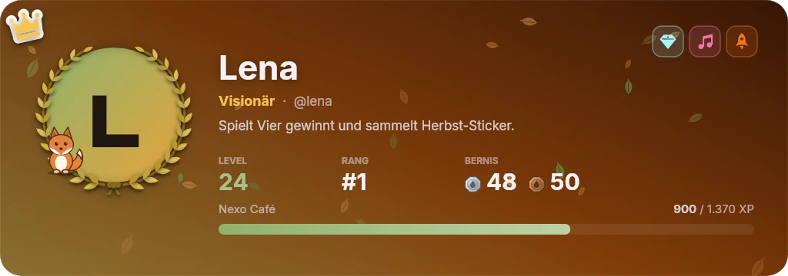

## Das Dashboard

Server-Admins richten Nexo im Browser ein, Mitglieder gestalten dort ihr Profil. Hell oder dunkel, in zwölf Farbvorlagen.

<table>
  <tr>
    <td width="50%">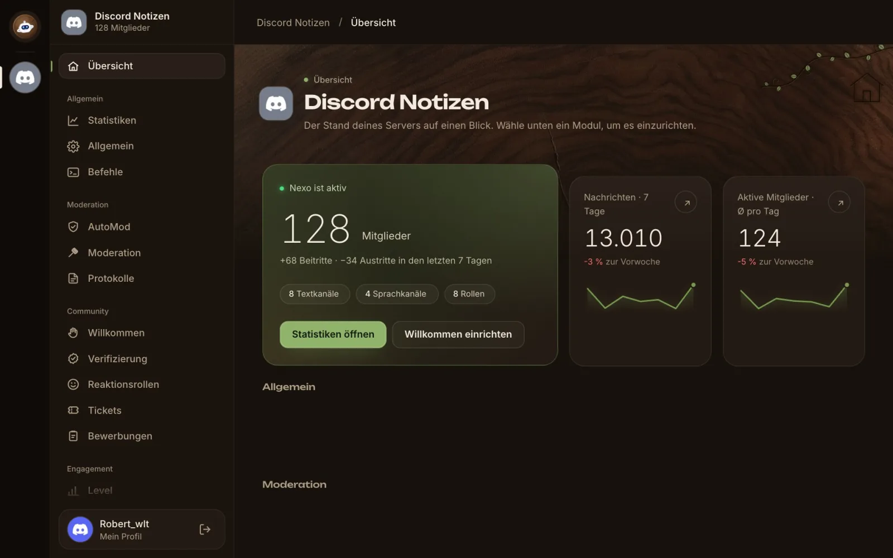</td>
    <td width="50%">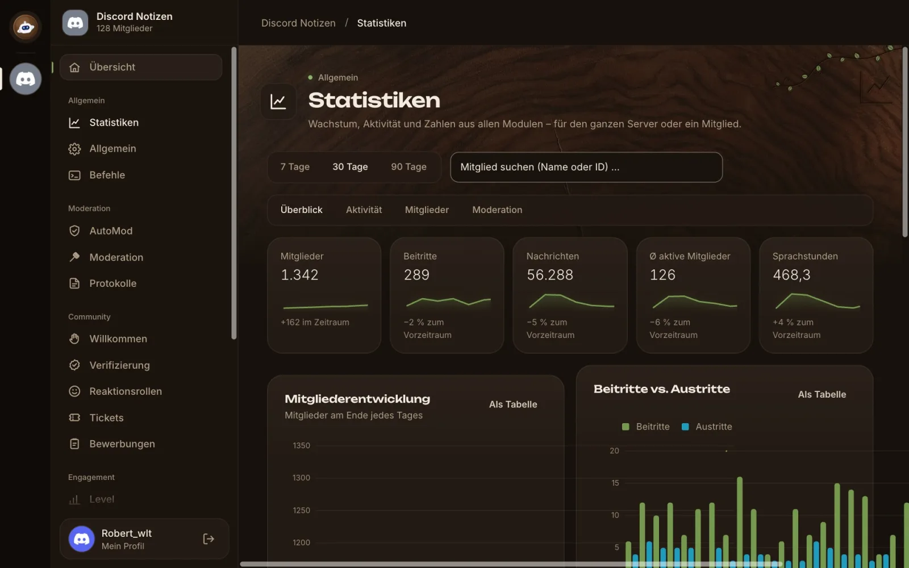</td>
  </tr>
  <tr>
    <td align="center"><b>Server-Übersicht</b> – alle Module auf einen Blick</td>
    <td align="center"><b>Statistiken</b> – Wachstum und Aktivität, täglich aufgezeichnet</td>
  </tr>
  <tr>
    <td>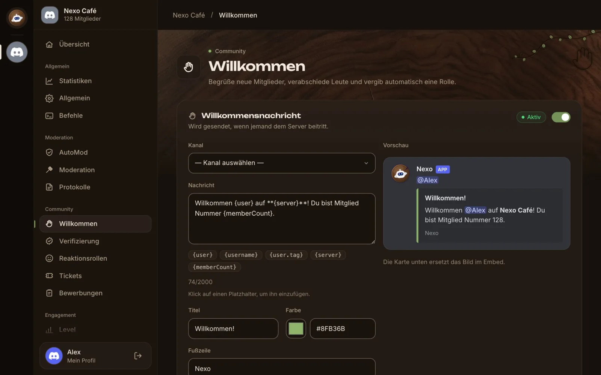</td>
    <td>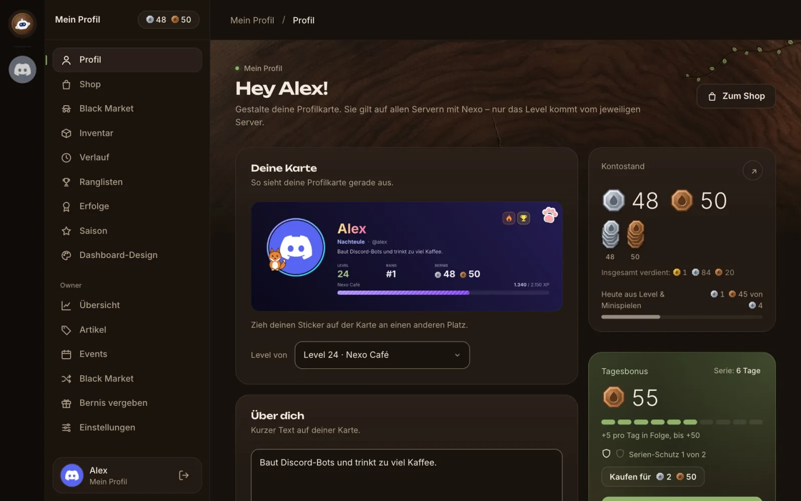</td>
  </tr>
  <tr>
    <td align="center"><b>Willkommen</b> – Nachricht mit Live-Vorschau</td>
    <td align="center"><b>Mein Profil</b> – Karte, Kontostand, Tagesbonus</td>
  </tr>
  <tr>
    <td>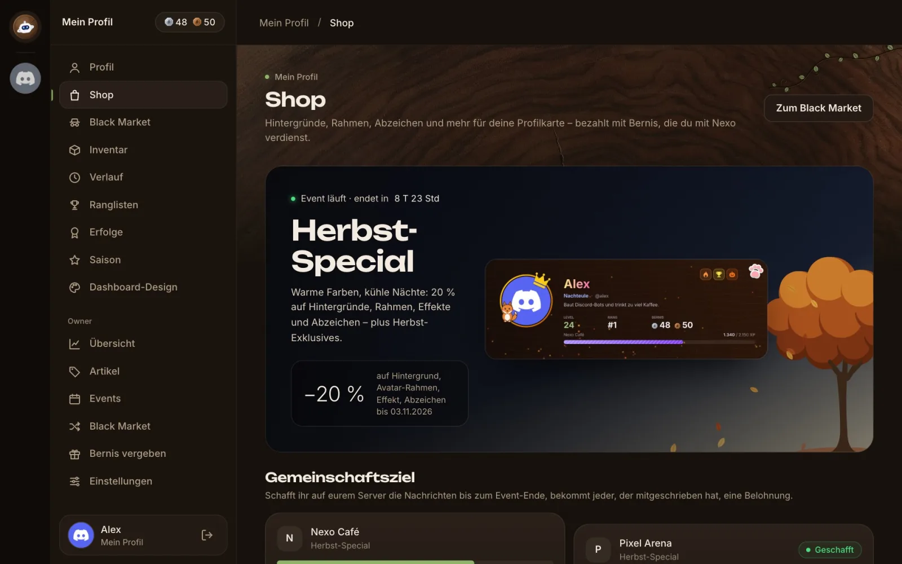</td>
    <td>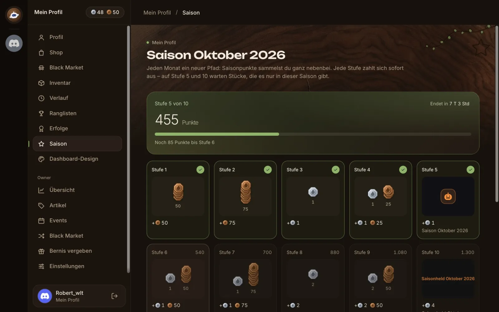</td>
  </tr>
  <tr>
    <td align="center"><b>Shop</b> – Events, Angebote und Gemeinschaftsziele</td>
    <td align="center"><b>Saison</b> – jeden Monat zehn Stufen</td>
  </tr>
  <tr>
    <td>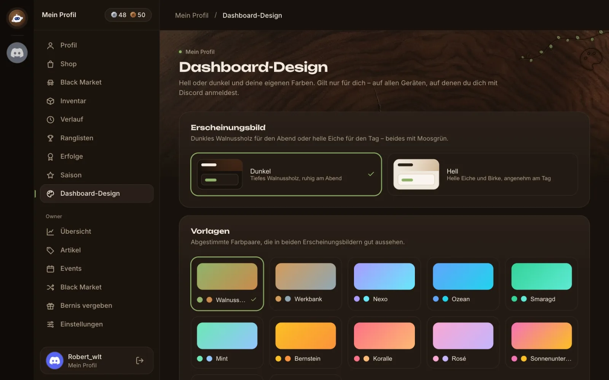</td>
    <td>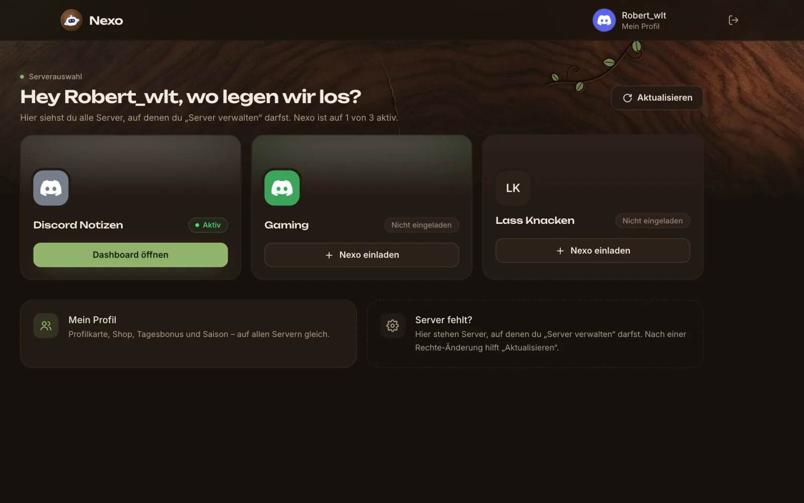</td>
  </tr>
  <tr>
    <td align="center"><b>Dashboard-Design</b> – zwölf Farbvorlagen, hell oder dunkel</td>
    <td align="center"><b>Serverauswahl</b> – alle eigenen Server, Nexo mit einem Klick einladen</td>
  </tr>
</table>

## Was Nexo kann

- **Moderation** – Verwarnungen, Timeouts, Bans, Fälle und Discords eingebauter AutoMod
- **Community** – Willkommen und Abschied mit eigenen Karten, Verifizierung, Reaktionsrollen, Tickets, Bewerbungen
- **Aktivität** – Level mit Rollen, Economy, Giveaways, Geburtstage, Zählspiel und Spiele wie Vier gewinnt
- **Profil** – Profilkarte, Shop und Schwarzmarkt, über 80 Erfolge, Tagesaufgaben, Saison und „Dein Nexo-Jahr“
- **Events** – saisonale Looks, Gemeinschaftsziele und Stücke, die es nur im Event gibt
- **Musik** – Warteschlange, Buttons und 24/7-Modus
- **Werkzeuge** – Statistiken, Logging, Join-to-Create, Server-Statistiken und mehr

Alles ist auf Deutsch, lässt sich pro Server ein- und ausschalten und ist kostenlos.

## Nexo nutzen

Fragen, Ideen und Bugs gehören in den [Discord-Server](https://discord.gg/DuhdCbTaB). Wer Nexo selbst betreiben will, findet Einrichtung, Umgebungsvariablen und Berechtigungen in [docs/SETUP.md](docs/SETUP.md).

  

  <b>Nexo · Ein Bot. Alle Funktionen.</b> 
  © 2026 Robertwlt03 · Veröffentlicht unter der <a href="LICENSE">MIT-Lizenz</a> 
  Hilfe, Bugs und Ideen: <a href="https://discord.gg/DuhdCbTaB">Discord-Server</a> 
  Basiert auf <a href="https://github.com/codebymitch/TitanBot">TitanBot</a> von codebymitch (MIT) und für NexoBot überarbeitet

